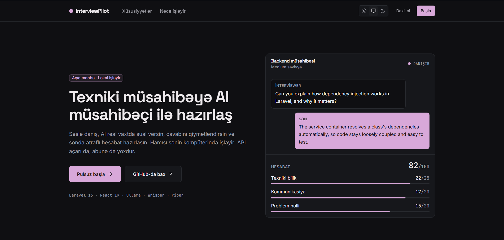
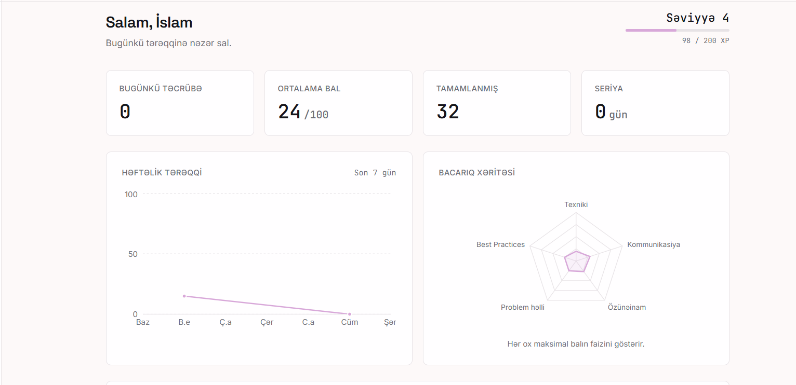
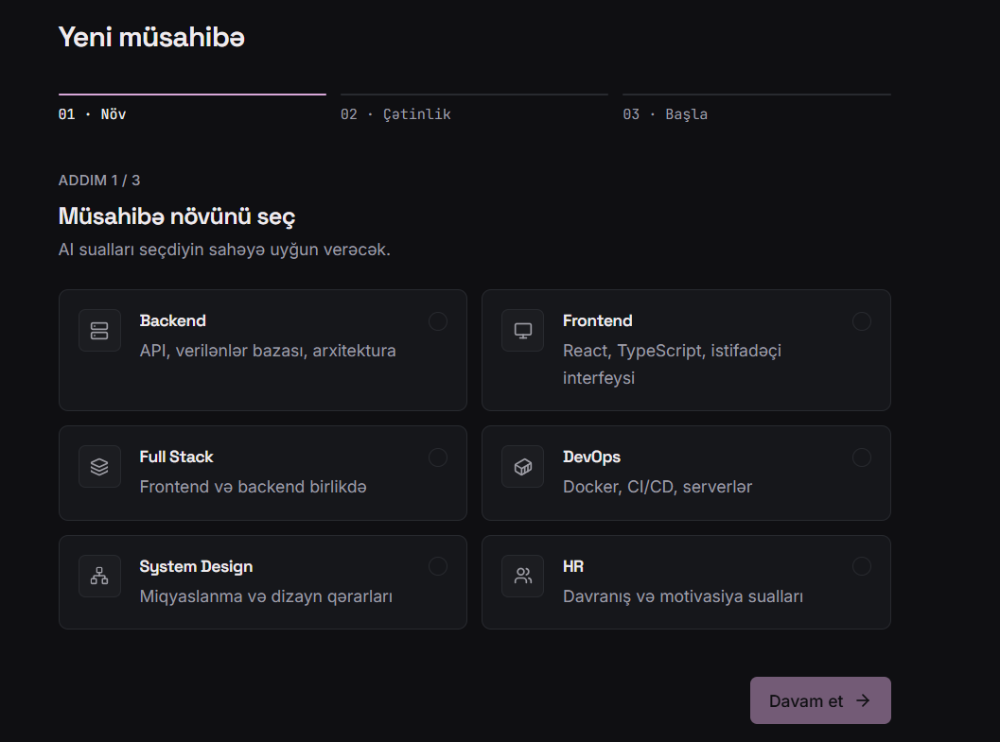
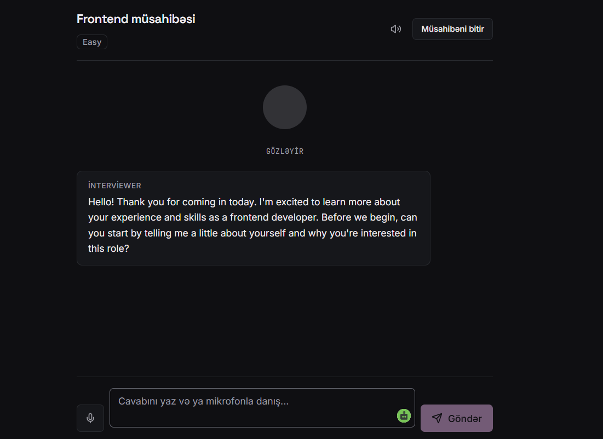
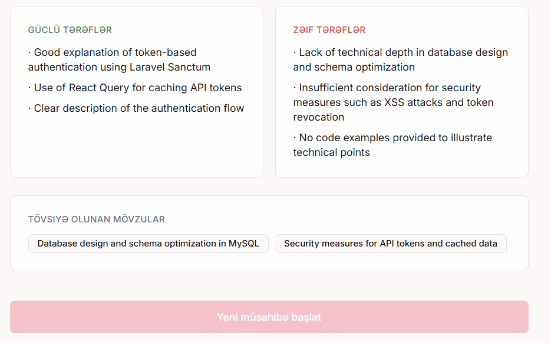
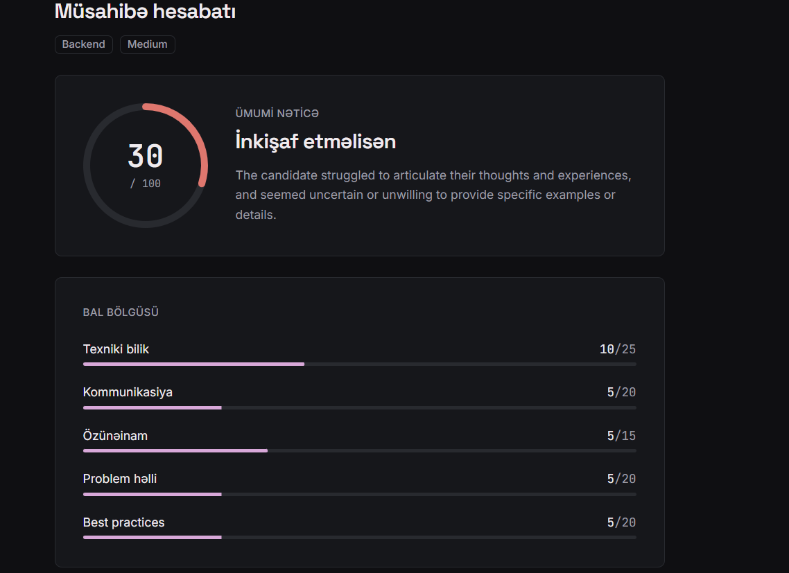
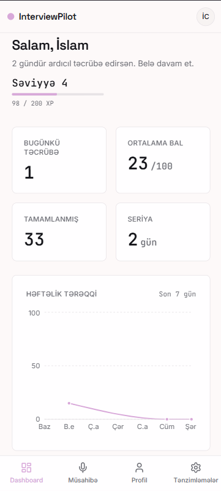
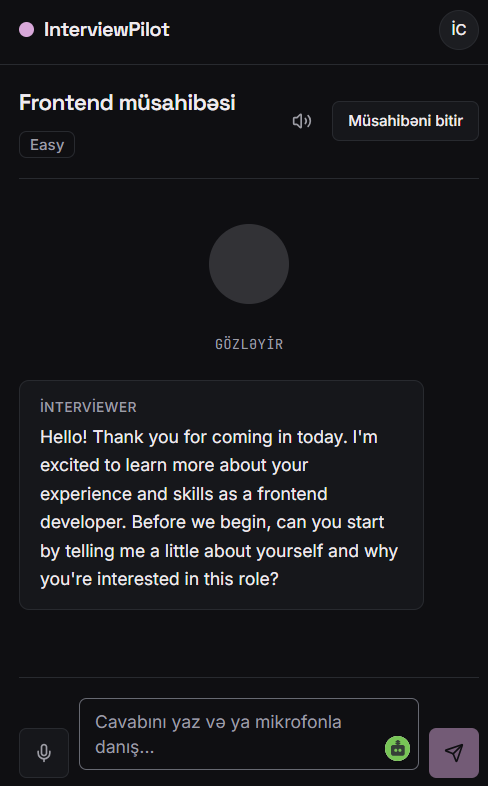

# InterviewPilot AI

> Practice real technical interviews with an AI interviewer. Open source, runs entirely on your machine.

[](LICENSE)

InterviewPilot AI is a self-hosted mock interview platform. A local LLM (Ollama) plays the interviewer,
Whisper transcribes your spoken answers, and Piper speaks the questions back. No API keys, no subscription,
and your voice, CV and answers never leave your machine.



## Features

- 🎙️ **Voice interviews**: speak your answers, the interviewer answers out loud (text works too)
- 🤖 **Local LLM** via Ollama, with streamed responses
- 📊 **AI evaluation report**: score breakdown, strengths, weak points, topics to study
- 📄 **CV-aware questions**: upload a PDF and the interviewer asks about your actual experience
- 🧭 **Guided setup**: pick the interview type and difficulty (Easy → Senior) step by step
- 📈 **Progress tracking**: weekly chart, skill map, recent interviews, XP, levels, streaks and badges
- ♿ **Accessible and responsive**: keyboard friendly, light/dark/system theme, reduced-motion support
- 🛠️ **Admin panel** (Filament) for users, interviews and reports
- 🐳 **Docker Compose** for the web stack

## Screenshots

| Dashboard | Dashboard (dark) |
|---|---|
|  | ) |

| Interview setup | Interview |
|---|---|
|  |  |

| Report | Mobile |
|---|---|
|   |   |

## Tech stack

| Layer | Technology |
|---|---|
| Backend | Laravel 13, PHP 8.4, Sanctum, Spatie Permission |
| Frontend | React 19, TypeScript, Vite, Tailwind CSS 4, TanStack Query, Zustand, Framer Motion |
| Database | PostgreSQL 16, Redis |
| LLM | Ollama (`llama3.1:8b` by default) |
| Speech-to-Text | faster-whisper |
| Text-to-Speech | Piper |
| Realtime | Laravel Reverb |
| Admin | Filament 5 |
| Tests | PHPUnit, Vitest, Testing Library, axe-core |

## Prerequisites

- Docker and Docker Compose
- [Ollama](https://ollama.com/download) installed on the host
- Python 3.11+ (only for optional voice features)
- ~8 GB free disk space for the model

## Installation

### 1. Install Ollama and pull a model

Ollama runs on your host (not in Docker), so it can use your GPU automatically
(NVIDIA, AMD or Apple Silicon).

```bash
ollama pull llama3.1:8b
```

Smaller GPU or CPU only? Use a lighter model and set `OLLAMA_MODEL` in `.env`, for example `llama3.2:3b`.

### 2. Clone and start the web stack

```bash
git clone https://github.com/IslamCabarli/InterviewPilot-AI.git
cd InterviewPilot-AI
cp apps/backend/.env.example apps/backend/.env
docker compose up -d --build
docker compose exec backend php artisan key:generate
docker compose exec backend php artisan migrate --seed
```

> Seeding is required: it creates the `user` and `admin` roles that registration depends on.

### 3. Open the app

- App: http://localhost:5173
- API docs (Swagger): http://localhost:8000/api/documentation
- Admin panel: http://localhost:8000/admin

### 4. (Optional) Enable voice

Without these two small services the app works in text-only mode.

- [Speech-to-Text setup](services/stt/README.md): speak your answers
- [Text-to-Speech setup](services/tts/README.md): hear the interviewer

### Creating an admin user

```bash
docker compose exec backend php artisan tinker
```

```php
\App\Models\User::where('email', 'you@example.com')->first()->assignRole('admin');
```

## Configuration

Key variables in `apps/backend/.env`:

| Variable | Default | Description |
|---|---|---|
| `OLLAMA_URL` | `http://host.docker.internal:11434` | Ollama endpoint |
| `OLLAMA_MODEL` | `llama3.1:8b` | Model name |
| `OLLAMA_NUM_CTX` | `4096` | Context window |
| `OLLAMA_NUM_PREDICT` | `300` | Max tokens per interviewer reply |
| `OLLAMA_KEEP_ALIVE` | `30m` | How long the model stays loaded |
| `WHISPER_URL` | `http://host.docker.internal:8001` | Speech-to-text service |
| `PIPER_URL` | `http://host.docker.internal:8002` | Text-to-speech service |
| `FRONTEND_URL` | `http://localhost:5173` | Allowed CORS origin(s), comma separated |

On Linux, `host.docker.internal` requires `extra_hosts: ["host.docker.internal:host-gateway"]`
on the backend service (already set in `docker-compose.yml`).

## Development

```bash
# Backend
docker compose exec backend php artisan test
docker compose exec backend ./vendor/bin/pint --test

# Frontend
docker compose exec frontend npm run test
docker compose exec frontend npx tsc -b
docker compose exec frontend npm run lint
```

CI runs the same checks on every push and pull request.

## Known limitations

- Voice features need two small services running on the host (not yet in Docker Compose).
- Piper currently has no Azerbaijani voice, so spoken output is English only.
- Interview quality depends on the local model you choose. Larger models give better questions and evaluation.

## Security notes for production

The defaults are tuned for local use. Before exposing the app publicly:

- Set `APP_ENV=production` and `APP_DEBUG=false`
- Generate fresh `APP_KEY` and Reverb keys, change the default PostgreSQL password
- Restrict `FRONTEND_URL` and Reverb `allowed_origins` to your domain
- Do not expose PostgreSQL (5433) or Redis (6379) to the internet
- Serve over HTTPS (browsers require it for microphone access)

## Known issues

- `league/commonmark` (transitive dependency of Laravel) has open advisories without a patched release yet.
  It is not used to render user-supplied content in this project. Acknowledged in `composer.json`
  (`config.audit.ignore`) and will be resolved with `composer update` once upstream ships a fix.

## Roadmap

- [x] Streamed interviewer responses
- [x] Redesigned, accessible, responsive UI
- [ ] Dockerize speech services
- [ ] Coding interview mode (Monaco editor)
- [ ] Whiteboard / system design mode
- [ ] Company-specific interview styles
- [ ] Full 3D avatar
- [ ] Skill tagging for per-technology progress

## Contributing

Issues and pull requests are welcome. Please open an issue before large changes.

## License

[MIT](LICENSE)